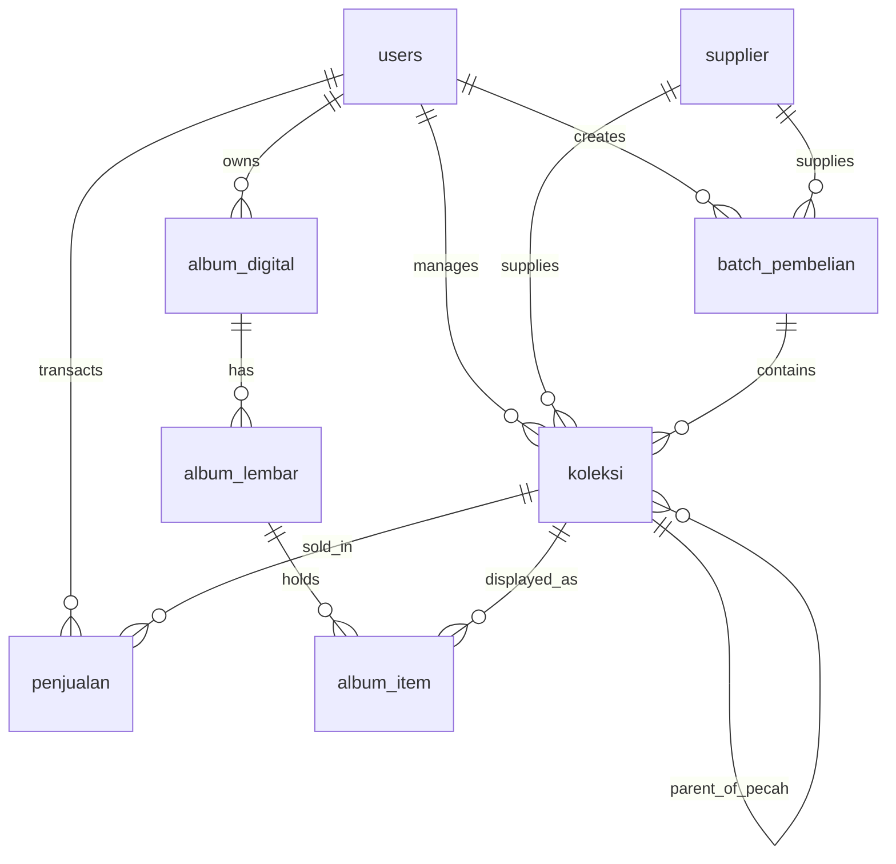

# 🚀 Catatan Tahapan Implementasi Proyek (Implementation Steps)
**Nama Aplikasi**: NumisManager (Platform Manajemen Koleksi Numismatik & Katalog Album Digital 3D)  
**Dokumentasi Lengkap**: Dari Perancangan Awal Hingga Siap Rilis (Production Ready)

---

## 📑 Daftar Isi
1. [Tahap 1: Analisis Kebutuhan Bisnis & Domain Numismatik](#tahap-1-analisis-kebutuhan-bisnis--domain-numismatik)
2. [Tahap 2: Pemilihan Arsitektur & Tech Stack](#tahap-2-pemilihan-arsitektur--tech-stack)
3. [Tahap 3: Perancangan Skema Database Relasional SQLite](#tahap-3-perancangan-skema-database-relasional-sqlite)
4. [Tahap 4: Implementasi Algoritma Finansial & HPP Koleksi](#tahap-4-implementasi-algoritma-finansial--hpp-koleksi)
5. [Tahap 5: Pembuatan REST API Backend (FastAPI)](#tahap-5-pembuatan-rest-api-backend-fastapi)
6. [Tahap 6: Perancangan UI/UX & Design System Numismatik](#tahap-6-perancangan-uiux--design-system-numismatik)
7. [Tahap 7: Pembangunan Frontend SPA (Single Page Application)](#tahap-7-pembangunan-frontend-spa-single-page-application)
8. [Tahap 8: Alur Kerja Pembelian Single & Batch Multi-Item](#tahap-8-alur-kerja-pembelian-single--batch-multi-item)
9. [Tahap 9: Fitur Pecah Stok, Penjualan & Ekspor Laporan Excel](#tahap-9-fitur-pecah-stok-penjualan--ekspor-laporan-excel)
10. [Tahap 10: Inovasi Album Digital Binder 3D Realistis](#tahap-10-inovasi-album-digital-binder-3d-realistis)
11. [Tahap 11: Iterasi Penyempurnaan, Backfill Aset & Perbaikan Bug](#tahap-11-iterasi-penyempurnaan-backfill-aset--perbaikan-bug)
12. [Tahap 12: Ekspansi 14 Tema Sampul, UX Refinement, Smart Tooltip & Dev Tooling](#tahap-12-ekspansi-14-tema-sampul-ux-refinement-smart-tooltip--dev-tooling)

---

## Tahap 1: Analisis Kebutuhan Bisnis & Domain Numismatik
Koleksi uang kuno (koin dan uang kertas) memiliki karakteristik unik yang tidak dapat diakomodasi oleh aplikasi inventaris umum / kasir toko ritel:
1. **Pengadaan Berganda (Lot/Batch Lelang)**: Kolektor sering membeli 1 lot lelang berisi 10–50 keping uang dengan 1 total ongkos kirim. Ongkos kirim ini harus dibagi rata (*equal split*) ke seluruh item agar Harga Pokok Penjualan (HPP) per keping terhitung akurat.
2. **Kondisi Fisik / Grading Standar Internasional**: Tiap lembar memiliki grade resmi (`UNC`, `AUNC`, `XF`, `VF`, `F`, `VG`, `POOR`) yang menentukan nilai jual dan kelangkaannya.
3. **Dokumentasi Dua Sisi (OBV & REV)**: Uang kertas dan koin memiliki dua muka (*Obverse* / tampak depan dan *Reverse* / tampak belakang) yang keduanya penting untuk verifikasi keaslian dan nomor seri (*Serial Number*).
4. **Pemisahan Tujuan Koleksi vs Stok Jual**: Sebagian barang disimpan sebagai koleksi pribadi, sementara sebagian lainnya disiapkan untuk dijual kembali.
5. **Simulasi Pengalaman Fisik (Buku Album Binder)**: Kolektor membutuhkan visualisasi buku album mika transparan asli untuk memamerkan dan mengagumi koleksinya tanpa merusak fisik uang aslinya.

---

## Tahap 2: Pemilihan Arsitektur & Tech Stack
Dipilih arsitektur yang ringan, mandiri (*self-contained*), cepat di-deploy, dan tidak memerlukan dependensi eksternal yang rumit:

* **Backend**: **Python 3.10+** dengan **FastAPI (ASGI)**. Menawarkan kecepatan setara NodeJS/Go, dokumentasi otomatis Swagger UI, serta validasi skema data ketat menggunakan Pydantic v2.
* **Database**: **SQLite** dengan **WAL Mode (Write-Ahead Logging)** dan *Foreign Key constraints*. Menghasilkan database serverless portabel 1 file (`numismatik.db`), tanpa perlu instalasi MySQL atau PostgreSQL terpisah.
* **Autentikasi**: **OAuth2 Password Bearer** dengan **JWT (JSON Web Token)** dan enkripsi kata sandi **Passlib Bcrypt**.
* **Frontend**: **Vanilla JavaScript (ES6+) SPA** + **CSS Variables Design Tokens** + **HTML5 Semantic**. Menghindari *framework bloatware* (React/Angular/Vue/Webpack/Vite) sehingga aplikasi dapat langsung berjalan tanpa proses `npm build` atau instalasi NodeJS di server.
* **Visualisasi & Reporting**: **Chart.js** (CDN) untuk grafik analitik, **OpenPyXL** untuk generasi laporan spreadsheet `.xlsx` bergaya profesional.

---

## Tahap 3: Perancangan Skema Database Relasional SQLite
Dibuat 8 tabel terelasi di dalam [`database/models.py`](file:///g:/AntigravityWorkspace/DashboardCollection/database/models.py):

1. **`users`**: Akun pengguna, role (`admin` / `user`), hashed password.
2. **`supplier`**: Sumber perolehan (pelelang FB, marketplace, kolektor rekanan, nomor HP, tautan profil).
3. **`batch_pembelian`**: Header pembelian lot (kode batch `BATCH-YYYYMMDD-NNN`, total ongkir, tanggal beli, supplier).
4. **`koleksi`**: Tabel utama master item (nama item, kode item `ITM-NNN`, nomor seri SN, tahun, denominasi, grade, jenis, negara, bahan, foto OBV/REV, qty, harga beli total, alokasi ongkir, HPP per pcs, status koleksi).
5. **`penjualan`**: Pencatatan penjualan (kode jual `JUAL-YYYYMMDD-NNN`, koleksi_id, qty terjual, harga jual pcs, HPP pcs, pembeli, platform, total profit).
6. **`album_digital`**: Metadata album buku (nama album, deskripsi, tema cover buku seperti burgundy/navy/emerald, kapasitas lembar).
7. **`album_lembar`**: Konfigurasi per lembar refill mika (nomor urut lembar, jumlah saku/slot: 1, 2, 3, 4, atau 6 slot).
8. **`album_item`**: Relasi penempatan item koleksi ke dalam lembar dan nomor slot saku mika tertentu.

---

## Tahap 4: Implementasi Algoritma Finansial & HPP Koleksi
Diimplementasikan di modul [`utils/calculations.py`](file:///g:/AntigravityWorkspace/DashboardCollection/utils/calculations.py):

### A. Rumus Pembelian Single Item:
$$\text{HPP Total} = \text{Harga Beli Total} + \text{Ongkos Kirim}$$
$$\text{HPP per Pcs} = \frac{\text{HPP Total}}{\text{Qty}}$$

### B. Rumus Pembelian Batch (Equal Split Freight):
Sesuai aturan industri numismatik, total ongkir dibagi rata ke jumlah keping/item di dalam lot (bukan proporsional harga):
$$\text{Alokasi Ongkir per Item} = \frac{\text{Total Ongkir Batch}}{\text{Jumlah Item dalam Batch}}$$
$$\text{HPP Item} = \text{Harga Beli Item} + \text{Alokasi Ongkir per Item}$$
$$\text{HPP per Pcs} = \frac{\text{HPP Item}}{\text{Qty Item}}$$

### C. Rumus Keuntungan & Margin Penjualan:
$$\text{Profit per Pcs} = \text{Harga Jual per Pcs} - \text{HPP per Pcs}$$
$$\text{Total Omset} = \text{Qty Jual} \times \text{Harga Jual per Pcs}$$
$$\text{Total Profit} = \text{Qty Jual} \times \text{Profit per Pcs}$$
$$\text{Margin Laba} = \left(\frac{\text{Total Profit}}{\text{Total Omset}}\right) \times 100\%$$

---

## Tahap 5: Pembuatan REST API Backend (FastAPI)
Dibangun 7 modul router independen yang terdaftar di [`main.py`](file:///g:/AntigravityWorkspace/DashboardCollection/main.py):
* **`/api/auth`**: Endpoint POST `/login`, POST `/register`, GET `/me`, CRUD users.
* **`/api/supplier`**: Pencarian supplier, riwayat pembelian dari supplier bersangkutan.
* **`/api/batch`**: Pembuatan lot batch, POST `/{id}/recalculate` untuk kalkulasi ulang HPP saat ongkir atau harga berubah.
* **`/api/koleksi`**: Filter canggih (search text, grade, jenis, status, rentang tahun, rentang harga modal, negara, nomor seri), upload foto multipart `tipe=obv` & `tipe=rev`, endpoint POST `/{id}/pecah`.
* **`/api/penjualan`**: Transaksi jual dengan proteksi validasi stok sisa $\ge$ kuantitas yang dijual.
* **`/api/laporan`**: Agregasi dashboard, data grafik bulanan, ekspor file spreadsheet `.xlsx` via `StreamingResponse`.
* **`/api/album`**: Manajemen binder album digital, konfigurasi lembar, penataan slot uang.

---

## Tahap 6: Perancangan UI/UX & Design System Numismatik
Dibuat antarmuka bernuansa **Luxury Dark-Gold Numismatic** pada [`static/css/style.css`](file:///g:/AntigravityWorkspace/DashboardCollection/static/css/style.css) & [`components.css`](file:///g:/AntigravityWorkspace/DashboardCollection/static/css/components.css):
* **Color Palette**: Dasar hitam obsidian (`#0a0c10`), kartu permukaan (`#12151c`), aksen emas numismatik murni (`#d4af37`), teks emas terang (`#f0c840`), serta warna status fungsional (hijau emerald untuk untung/UNC, merah crimson untuk rugi/POOR).
* **Tipografi**: Menggunakan font modern Google Fonts **Inter** dengan kerning tajam dan angka monospace pada kode seri.
* **Micro-interactions**: Efek glassmorphism (`backdrop-filter: blur`), gold border glow saat kursor melintas, dan animasi transisi halus.

---

## Tahap 7: Pembangunan Frontend SPA (Single Page Application)
Arsitektur perutean (*routing*) tanpa reload halaman:
* Menggunakan teknik **Hash Routing (`#dashboard`, `#koleksi`, `#album`, dll.)** yang terdaftar pada [`templates/app.html`](file:///g:/AntigravityWorkspace/DashboardCollection/templates/app.html).
* Navigasi sidebar responsif yang dapat di-*toggle* mengecil menjadi **Icon-only Rail (68px)** pada desktop atau *slide-in drawer* pada layar ponsel.
* State tersimpan di `localStorage` (`numis_token`, `numis_user`, `numis_sidebar_collapsed`).

---

## Tahap 8: Alur Kerja Pembelian Single & Batch Multi-Item
* **Input Tunggal (Single)**: Entri cepat untuk 1 uang langka bernilai tinggi beserta foto obverse dan reverse.
* **Input Lot (Batch)**:
  * Tampilan *dual-panel* (daftar batch di kiri yang bisa di-hide/show agar ruang kerja leluasa).
  * Penginputan item batch langsung menghitung live hint harga per keping: `@ Rp 1.000/pcs`.
  * Tombol re-kalkulasi instan jika biaya pengiriman paket lelang berubah.

---

## Tahap 9: Fitur Pecah Stok, Penjualan & Ekspor Laporan Excel
* **Pecah Stok (Stock Splitting)**: Mengatasi kasus ketika 1 gepok (misal 100 lembar) dibeli bersamaan, lalu 1 lembar bernomor seri unik (*solid / radar*) ingin dipisahkan untuk dijual dengan harga premium tersendiri. Fitur ini secara otomatis mengurangi kuantitas induk dan mewariskan HPP modal aslinya secara presisi ke anak item.
* **Quick Sale Modal**: Tombol cepat di tabel koleksi untuk menjual item secara instan dengan preview laba kotor sebelum konfirmasi.
* **Ekspor Excel Multi-Sheet**: Generator laporan profesional berkepala emas (`#D4AF37`) dengan rumus dan format angka Rupiah standar akuntansi.

---

## Tahap 10: Inovasi Album Digital Binder 3D Realistis
Fitur unggulan visualisasi buku album mika koleksi asli ([`static/css/album.css`](file:///g:/AntigravityWorkspace/DashboardCollection/static/css/album.css) & [`static/js/album.js`](file:///g:/AntigravityWorkspace/DashboardCollection/static/js/album.js)):
1. **Konstruksi Buku Binder Fisik**: Dilengkapi sampul bertekstur kulit & gradien metalik, 4 ring besi tembaga emas di tengah, jahitan tepi (*stitched edge*), dan lapisan refleksi kilap mika transparan (*high-gloss cellophane*).
2. **Kaidah Lembar vs Halaman Numismatik**:
   * Saat album pertama kali dibuka: Sebelah kiri adalah **Sampul Depan Dalam (Kosong)**, sebelah kanan adalah **Halaman 1 (Sisi Depan / OBS Lembar 1)**.
   * Saat lembar pertama dibalik ke kiri: Sebelah kiri menjadi **Halaman 2 (Sisi Belakang / REV Lembar 1)**, sebelah kanan menjadi **Halaman 3 (Sisi Depan / OBS Lembar 2)**.
   * Hingga lembar terakhir dibalik: Sebelah kiri adalah sisi REV lembar terakhir, dan sebelah kanan adalah Sampul Belakang Dalam.
3. **Kustomisasi Layout Slot per Lembar**: Tiap lembar dapat diatur mandiri memuat 1 uang besar, 2 uang, 3 uang standar, 4 uang grid, atau 6 koin per lembar dalam satu album yang sama.
4. **Fisika 3D Drag-to-Flip Nyata Dua Arah**:
   * Pengguna dapat membalik halaman dengan menggeser kursor (klik & drag) atau menekan tombol navigasi toolbar.
   * **Membuka Halaman Kanan (Drag Kiri)**: Lembaran terangkat dari kanan dan berputar $0^\circ \rightarrow -180^\circ$ di sekitar ring tengah, jatuh rata di sebelah kiri.
   * **Membuka Halaman Kiri (Drag Kanan)**: Lembaran terangkat dari kiri dan berputar $0^\circ \rightarrow +180^\circ$ di sekitar ring tengah, jatuh rata di sebelah kanan.
   * Halaman statis di bawahnya secara otomatis me-*render* lembar berikutnya/sebelumnya saat lembaran mulai terangkat (*pre-reveal*).
5. **Indikator Lembaran Dinamis**: Dilengkapi pill penunjuk posisi lembar (*misal: "Lembar 1/5", "Lembar 2/5"*) yang ditempatkan secara elegan di antara nomor halaman dan tombol pengatur slot refill.
6. **Modal Pemilih Koleksi & Detail Ultra-Lebar**:
   * Jendela *Pilih Koleksi untuk Lembar* didesain lebar dengan fitur pencarian instan (ikon kaca pembesar `🔍`) dan filter multi-kriteria (ikon corong `🔽`) yang dapat di-*show/hide*.
   * Modal *Lihat Detail Item Lengkap* di album digital diperluas menjadi tampilan 2 kolom responsif tanpa perlu *scrolling* untuk mengamati foto tampak depan (OBV), tampak belakang (REV), dan 14 spesifikasi teknis uang kuno.

---

## Tahap 11: Iterasi Penyempurnaan, Backfill Aset & Perbaikan Bug
* **Zero Broken Image Fallback**: Menambahkan handler `onerror` pada seluruh tag gambar yang secara otomatis mengalihkan tautan bermasalah ke logo aplikasi tanpa memunculkan kotak silang browser.
* **Backfill Aset Koleksi Awal**: Membuat skrip backfill yang men-generate ilustrasi SVG tampak depan dan belakang untuk item koleksi lawas.
* **Global Floating Lightbox**: Mengganti preview lama dengan modal mengambang resolusi penuh tanpa merusak/menutup jendela rincian data koleksi yang sedang dilihat.
* **Tooltip Cerdas Anti-Terpotong (Smart Downward Tooltip)**:
  * Memperbaiki bug tampilan tooltip pada 3 item teratas di tabel Koleksi & Stok dengan menerapkan class `.tooltip-down` dan posisi `top: calc(100% + 8px); bottom: auto;` sehingga tooltip membuka ke arah bawah.
  * Memberikan `z-index: 1050` pada baris yang sedang aktif agar tooltip selalu berada di lapisan terdepan.
* **Penyederhanaan Tampilan Baris Tabel Koleksi**:
  * Menghilangkan teks keterangan panjang dalam kurung pada kolom *Nama Item* agar tata letak tabel tetap rapi, kompak, dan proporsional. Seluruh rincian/sertifikasi tetap tersimpan utuh dan dapat dilihat pada modal detail view (`👁️`).
* **Dual-Photo Tooltip pada Dashboard**:
  * Mengonversi daftar *Item Koleksi Terbaru* pada dashboard utama dari gambar statis menjadi tooltip hover dua sisi yang identik dengan menu koleksi.

---

## Tahap 12: Ekspansi 14 Tema Sampul, UX Refinement, Smart Tooltip & Dev Tooling
1. **14 Tema Warna Sampul Mewah (Luxury Binder Themes)**:
   * Mengembangkan sistem tema dengan gradien metalik mendalam (*radial highlight* & *linear leather luster*) mencakup:
     * **Gold**: Emas murni berkilau (*Luxury Bullion*)
     * **Silver**: Perak murni (*Brushed Sterling Silver & Platinum Border*)
     * **Copper / Cupper**: Tembaga antik (*Antique Warm Copper Bronze*)
     * **Rose Gold**: Rose gold premium (*Blushed Pink-Gold Metallic*)
     * **White Gold**: White gold (*Pale Platinum Champagne & Pearl Sheen*)
     * **Hijau**: Hijau zamrud (*Royal Classic Emerald Green*)
     * **Biru**: Biru tua kerajaan (*Deep Royal Navy Blue*)
     * **Merah**: Merah marun elegan (*Deep Burgundy Crimson*)
     * **Purple / Purpple**: Ungu kerajaan (*Imperial Royal Purple*)
     * **Violet**: Deep violet / lembayung (*Mystical Amethyst Violet*)
     * **Yellow**: Kuning amber (*Vibrant Golden Citrine*)
     * **Desert Sand / Dessert**: Gurun pasir (*Warm Sahara Desert Sand Leather*)
     * **Vintage Leather**: Kulit cokelat klasik (*Aged Saddle Brown Leather*)
     * **Onyx Black**: Hitam onyx mewah (*Obsidian Carbon Black*)
   * **Live Theme Preview Box**: Kotak pratinjau warna langsung pada modal pembuatan dan pengeditan album sebelum disimpan.
   * **Tombol Tema Cepat Toolbar**: Menambahkan tombol `🎨 Tema & Pengaturan` langsung di toolbar penampil album digital agar pengguna dapat berganti warna sampul secara instan tanpa harus keluar ke rak album.
2. **Standardisasi Struktur Repositori**:
   * Merapikan direktori proyek dengan memindahkan seluruh dokumentasi dari folder `Others/` ke dalam folder standar **`docs/`**.
   * Menambahkan berkas `README.md` induk di root direktori sebagai dokumentasi arsitektur dan panduan pengguna.
   * Menambahkan konfigurasi `.gitignore` standar Python untuk mengecualikan file virtual environment, cache, dan binary.
3. **Automasi Pengujian Jarak Jauh (Remote Access & Mobile Testing)**:
   * Mengintegrasikan Cloudflare Tunnel standalone (`cloudflared.exe`) dan membuat skrip peluncur 1-klik `tunnel.bat` untuk mempermudah pengujian dari perangkat mobile (HP/tablet) maupun laptop lain melalui jaringan internet publik.
4. **Cache Busting Produksi**:
   * Meningkatkan penanda versi aset di `templates/app.html` ke parameter `?v=14` untuk memastikan browser pengguna selalu menyajikan antarmuka terbaru.
