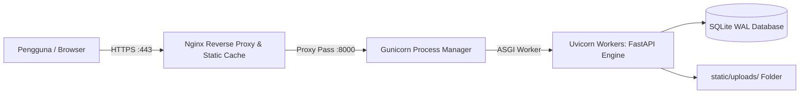

# 🌐 Panduan Deployment Lengkap: Local & Cloud Hosting
**Aplikasi**: NumisManager (Dashboard Manajemen Koleksi Numismatik & Katalog Album Digital)  
**Target Pembaca**: Pemilik Aplikasi, Pengembang, dan Administrator Sistem  

---

## 📑 Daftar Isi
1. [Persyaratan Sistem (Prerequisites)](#1-persyaratan-sistem-prerequisites)
2. [Panduan Deploy di Komputer Lokal (Windows, macOS, Linux)](#2-panduan-deploy-di-komputer-lokal-windows-macos-linux)
3. [Mengakses Aplikasi dari HP / Tablet (WiFi Lokal & Cloudflare Tunnel Remote)](#3-mengakses-aplikasi-dari-hp--tablet-wifi-lokal--cloudflare-tunnel-remote)
4. [Rekomendasi Layanan Hosting Terbaik](#4-rekomendasi-layanan-hosting-terbaik)
5. [Panduan Deploy di Cloud VPS Linux (Ubuntu Server) - Metode Produksi](#5-panduan-deploy-di-cloud-vps-linux-ubuntu-server---metode-produksi)
6. [Panduan Deploy Praktis di PaaS (Railway / Render)](#6-panduan-deploy-praktis-di-paas-railway--render)
7. [Deploy Menggunakan Docker & Docker Compose](#7-deploy-menggunakan-docker--docker-compose)
8. [Strategi Backup Database SQLite Otomatis](#8-strategi-backup-database-sqlite-otomatis)
9. [Checklist Keamanan Sebelum Go-Live (Security Checklist)](#9-checklist-keamanan-sebelum-go-live-security-checklist)

---

## 1. Persyaratan Sistem (Prerequisites)
Aplikasi NumisManager dirancang sangat efisien tanpa memerlukan Node.js atau server database berat (MySQL/PostgreSQL) karena telah terintegrasi dengan engine **SQLite WAL**:
* **Python**: Versi **3.10** atau lebih baru (Python 3.10, 3.11, atau 3.12).
* **RAM**: Minimal **512 MB** (Sangat ringan; aplikasi hanya memakai ~60 MB RAM).
* **Penyimpanan (Disk)**: Minimal **500 MB** untuk aplikasi, database, dan foto koleksi.

---

## 2. Panduan Deploy di Komputer Lokal (Windows, macOS, Linux)

### A. Di Komputer Windows:
1. **Buka Terminal / PowerShell / Command Prompt** pada folder project:
   ```powershell
   cd g:\AntigravityWorkspace\DashboardCollection
   ```
2. **Buat Virtual Environment (Sangat Dianjurkan)**:
   ```powershell
   python -m venv venv
   .\venv\Scripts\Activate.ps1
   ```
   *(Jika muncul error Execution Policy di PowerShell, jalankan `Set-ExecutionPolicy -Scope Process -ExecutionPolicy Bypass` lalu ulangi).*
3. **Instal Dependensi**:
   ```powershell
   pip install -r requirements.txt
   ```
4. **Jalankan Aplikasi**:
   ```powershell
   python main.py
   ```
5. **Buka Browser**:
   * Akses URL: **`http://localhost:8000`**
   * Login Default:
     * **Username**: `admin`
     * **Password**: `admin123`

#### 💡 Menjalankan Otomatis dengan 1-Klik (Windows Shortcut):
Di dalam folder project telah tersedia berkas `run.bat`. Cukup klik dua kali berkas `run.bat` untuk langsung mengaktifkan server dan membuka dashboard di browser.

---

### B. Di Komputer macOS / Linux:
1. Buka Terminal dan arahkan ke direktori:
   ```bash
   cd /path/to/DashboardCollection
   ```
2. Buat & aktifkan virtual environment:
   ```bash
   python3 -m venv venv
   source venv/bin/activate
   ```
3. Instal dependensi:
   ```bash
   pip install -r requirements.txt
   ```
4. Jalankan aplikasi:
   ```bash
   python3 main.py
   ```
   Akses di browser pada `http://localhost:8000`.

---

## 3. Mengakses Aplikasi dari HP / Tablet (WiFi Lokal & Cloudflare Tunnel Remote)
Karena aplikasi ini responsif di ponsel dan tablet (termasuk pengalaman membalik lembaran album digital dengan *touchscreen*), Anda dapat membukanya dari perangkat apa saja melalui dua metode berikut:

### Metode A: Mengakses Melalui Jaringan WiFi yang Sama (Lokal)
1. Pada komputer server/host (Windows), cari tahu IP lokal komputer Anda:
   * Buka PowerShell / CMD, ketik: `ipconfig`
   * Temukan **IPv4 Address**, misalnya: `192.168.1.15`
2. Pastikan `main.py` menggunakan host `0.0.0.0`:
   ```python
   uvicorn.run(app, host="0.0.0.0", port=8000)
   ```
   *(Kode project Anda sudah tersetting `0.0.0.0` secara bawaan).*
3. Buka browser di HP/Tablet Anda, lalu ketik:
   **`http://192.168.1.15:8000`**
4. *Catatan*: Jika tidak bisa terbuka, izinkan port 8000 pada Windows Defender Firewall:
   * Buka *Windows Defender Firewall with Advanced Security* -> *Inbound Rules* -> *New Rule* -> Pilih *Port* -> Masukkan `8000` -> *Allow the connection*.

### Metode B: Mengakses dari Mana Saja via Internet Publik (1-Klik via `tunnel.bat`)
Jika Anda berada di luar rumah/kantor, menggunakan koneksi data seluler (4G/5G), atau terhubung ke WiFi berbeda:
1. Pastikan server aplikasi telah aktif (melalui `run.bat` atau `python main.py`).
2. Klik dua kali berkas **`tunnel.bat`** di folder proyek.
3. Skrip akan otomatis mengaktifkan **Cloudflare Quick Tunnel** menggunakan `cloudflared.exe`.
4. Salin tautan publik berawalan HTTPS yang muncul di jendela konsol (misalnya: `https://xxxx-xxxx-xxxx.trycloudflare.com`).
5. Buka tautan tersebut di peramban ponsel, tablet, atau laptop manapun di seluruh dunia tanpa perlu konfigurasi router atau IP publik statis.

---

## 4. Rekomendasi Layanan Hosting Terbaik

Memilih hosting untuk aplikasi Python FastAPI + SQLite memiliki kriteria utama: **Penyimpanan Persistent (Disk tidak boleh ter-reset saat restart server)** agar database `numismatik.db` dan foto-foto di `static/uploads/` tetap aman.

Berikut rekomendasi terbaik berdasarkan performa, kemudahan, dan biaya:

| Nama Penyedia | Kategori | Biaya Bulanan | Performa & Kelebihan | Cocok Untuk |
| :--- | :---: | :---: | :--- | :--- |
| **Hetzner Cloud** | Cloud VPS | **~€3.79 (± Rp 65.000)** | **Performa Terbaik di Dunia**. CPU AMD EPYC / ARM super cepat, RAM 2-4 GB, NVMe SSD, traffic 20 TB. | **Pilihan Utama (Rekomendasi #1)** jika ingin performa maksimal dengan harga paling ekonomis. |
| **DigitalOcean** | Cloud VPS | **$4 - $6 (± Rp 95.000)** | **Sangat Stabil & Dokumentasi Lengkap**. Fitur snapshot backup otomatis, floating IP, sangat mudah digunakan pemula. | Pilihan favorit developer profesional untuk stabilitas jangka panjang. |
| **IDCloudHost / Niagahoster** | VPS Lokal ID | **Rp 50.000 - Rp 90.000** | **Latensi Terendah (<15 ms di Indonesia)**. Lokasi data center di Jakarta, pembayaran mudah via QRIS/BCA/Mandiri. | Akses super kencang untuk pengguna yang berlokasi di Indonesia. |
| **Railway.app** | PaaS (No-Ops) | **$5 (± Rp 80.000)** | **Deploy Otomatis via GitHub**. Tidak perlu kelola OS Linux. Mendukung *Persistent Volume* untuk SQLite. | Bagi yang tidak ingin repot mengonfigurasi Linux VPS / Nginx. |
| **Render.com** | PaaS (No-Ops) | **$7 (± Rp 110.000)** | **Setup Cepat**. Mendukung Python Web Service dengan Persistent Disk mount. | Alternatif PaaS yang andal dengan SSL gratis otomatis. |

> ⚠️ **Peringatan Penting untuk Hosting Gratis (Vercel / Heroku / Netlify)**:
> Jangan deploy aplikasi ini di Vercel atau serverless gratisan! Vercel dan Heroku Free memiliki sistem file *ephemeral* (sementara), yang akan menghapus file SQLite dan foto unggahan setiap kali aplikasi mengalami *sleep* atau *deploy ulang*. Gunakan **VPS** atau **PaaS dengan Persistent Volume**.

---

## 5. Panduan Deploy di Cloud VPS Linux (Ubuntu Server) - Metode Produksi

Metode ini adalah standar industri terbaik (*Gold Standard*) untuk performa maksimal, keamanan tinggi, dan biaya murah.

### Arsitektur Produksi:


---

### Langkah 1: Persiapan Server Ubuntu (22.04 / 24.04 LTS)
Hubungkan ke VPS via SSH:
```bash
ssh root@IP_SERVER_ANDA
```
Lakukan pembaruan sistem dan pasang paket yang diperlukan:
```bash
apt update && apt upgrade -y
apt install -y python3 python3-pip python3-venv git nginx certbot python3-certbot-nginx ufw
```

---

### Langkah 2: Salin Berkas Proyek ke Server
Letakkan project di `/var/www/numismanager`:
```bash
mkdir -p /var/www/numismanager
cd /var/www/numismanager
```
Anda dapat meng-*clone* dari repositori Git atau mengunggah berkas zip project Anda via SCP/FileZilla.

Pastikan struktur direktori berada di tempat yang benar:
```bash
# Buat direktori upload jika belum ada
mkdir -p /var/www/numismanager/static/uploads
# Berikan hak akses ke user www-data
chown -R www-data:www-data /var/www/numismanager
chmod -R 775 /var/www/numismanager/static/uploads
```

---

### Langkah 3: Setup Virtual Environment & Pasang Library
```bash
cd /var/www/numismanager
python3 -m venv venv
source venv/bin/activate
pip install --upgrade pip
pip install -r requirements.txt
pip install gunicorn
```

---

### Langkah 4: Konfigurasi Systemd Service (Auto-Start & Background Daemon)
Agar aplikasi otomatis hidup saat server dinyalakan dan otomatis me-restart jika terjadi *crash*, buat berkas service systemd:

```bash
nano /etc/systemd/system/numismanager.service
```

Isi dengan konfigurasi berikut:
```ini
[Unit]
Description=NumisManager FastAPI Application
After=network.target

[Service]
User=www-data
Group=www-data
WorkingDirectory=/var/www/numismanager
Environment="PATH=/var/www/numismanager/venv/bin"
ExecStart=/var/www/numismanager/venv/bin/gunicorn main:app \
    --workers 3 \
    --worker-class uvicorn.workers.UvicornWorker \
    --bind 127.0.0.1:8000 \
    --access-logfile /var/log/numismanager_access.log \
    --error-logfile /var/log/numismanager_error.log

Restart=always
RestartSec=5

[Install]
WantedBy=multi-user.target
```

Aktifkan dan jalankan service:
```bash
systemctl daemon-reload
systemctl enable numismanager
systemctl start numismanager
systemctl status numismanager
```

---

### Langkah 5: Konfigurasi Nginx sebagai Reverse Proxy & Static Cache
Nginx bertugas menangani koneksi SSL HTTPS, mengompresi aset (gzip), dan melayani file statis secara langsung tanpa membebani proses Python:

```bash
nano /etc/nginx/sites-available/numismanager
```

Isi konfigurasi berikut (ganti `koleksi.domainanda.com` dengan domain Anda atau IP server):
```nginx
server {
    listen 80;
    server_name koleksi.domainanda.com; # Ganti dengan domain Anda

    client_max_body_size 50M;

    # Melayani berkas statis langsung dari Nginx (Sangat Cepat & Hemat Memori)
    location /static/ {
        alias /var/www/numismanager/static/;
        expires 30d;
        add_header Cache-Control "public, no-transform";
    }

    # Proxy request dinamis & API ke FastAPI Gunicorn
    location / {
        proxy_pass http://127.0.0.1:8000;
        proxy_set_header Host $host;
        proxy_set_header X-Real-IP $remote_addr;
        proxy_set_header X-Forwarded-For $proxy_add_x_forwarded_for;
        proxy_set_header X-Forwarded-Proto $scheme;
        
        # Timeout settings untuk upload gambar resolusi tinggi
        proxy_connect_timeout 60s;
        proxy_read_timeout 60s;
    }
}
```

Aktifkan konfigurasi di Nginx:
```bash
ln -s /etc/nginx/sites-available/numismanager /etc/nginx/sites-enabled/
nginx -t
systemctl restart nginx
```

---

### Langkah 6: Pasang Sertifikat SSL Gratis (HTTPS) dengan Let's Encrypt
Jalankan satu perintah ini untuk mengamankan website dengan gembok hijau HTTPS:
```bash
certbot --nginx -d koleksi.domainanda.com
```
Certbot akan otomatis memperbarui sertifikat SSL setiap 90 hari.

---

## 6. Panduan Deploy Praktis di PaaS (Railway / Render)
Jika Anda tidak ingin mengelola server Linux sendiri, gunakan **Railway.app**:

1. Buat akun di [Railway.app](https://railway.app).
2. Hubungkan repositori GitHub project Anda.
3. **Paling Penting: Tambahkan Persistent Volume**:
   * Masuk ke *Settings* project Railway -> Pilih *Volumes*.
   * Tambahkan Volume baru dan mount path ke:
     * `/app/database` (untuk database SQLite `numismatik.db`)
     * `/app/static/uploads` (untuk foto koleksi)
4. Masukkan start command:
   ```bash
   uvicorn main:app --host 0.0.0.0 --port $PORT
   ```
5. Railway akan memberikan domain publik gratis dengan HTTPS (misal: `numismanager.up.railway.app`).

---

## 7. Deploy Menggunakan Docker & Docker Compose
Bagi pengguna Docker, aplikasi ini dapat dijalankan dalam 1 baris perintah:

### A. Berkas `Dockerfile`:
```dockerfile
FROM python:3.11-slim

WORKDIR /app

RUN apt-get update && apt-get install -y --no-install-recommends \
    build-essential \
    && rm -rf /var/lib/apt/lists/*

COPY requirements.txt .
RUN pip install --no-cache-dir -r requirements.txt

COPY . .

# Buat direktori data
RUN mkdir -p /app/static/uploads /app/database

EXPOSE 8000

CMD ["uvicorn", "main:app", "--host", "0.0.0.0", "--port", "8000"]
```

### B. Berkas `docker-compose.yml`:
```yaml
version: '3.8'

services:
  web:
    build: .
    container_name: numismanager_app
    restart: always
    ports:
      - "8000:8000"
    volumes:
      # Data persisten agar data tidak hilang saat container di-restart
      - ./database:/app/database
      - ./static/uploads:/app/static/uploads
    environment:
      - PYTHONUNBUFFERED=1
```

Jalankan container di server:
```bash
docker compose up -d
```

---

## 8. Strategi Backup Database SQLite Otomatis
Karena seluruh data tersimpan rapi dalam berkas `database/numismatik.db`, pencadangan (*backup*) sangat mudah dilakukan. 

Buat skrip backup otomatis harian:
```bash
nano /var/www/numismanager/backup.sh
```

Isi skrip:
```bash
#!/bin/bash
BACKUP_DIR="/var/backups/numismatik"
mkdir -p $BACKUP_DIR

TIMESTAMP=$(date +"%Y%m%d_%H%M%S")
DB_FILE="/var/www/numismanager/database/numismatik.db"
BACKUP_FILE="$BACKUP_DIR/numismatik_$TIMESTAMP.sqlite3"

# Gunakan fitur backup online SQLite agar data konsisten meskipun sedang diakses
sqlite3 $DB_FILE ".backup '$BACKUP_FILE'"

# Kompresi berkas backup
gzip -f $BACKUP_FILE

# Hapus backup yang usianya lebih dari 30 hari
find $BACKUP_DIR -name "*.gz" -mtime +30 -delete

echo "Backup selesai: $BACKUP_FILE.gz"
```

Beri izin eksekusi dan pasang di `crontab` agar berjalan otomatis setiap jam 02:00 pagi:
```bash
chmod +x /var/www/numismanager/backup.sh
crontab -e
```
Tambahkan baris berikut di akhir:
```cron
0 2 * * * /var/www/numismanager/backup.sh > /dev/null 2>&1
```

---

## 9. Checklist Keamanan Sebelum Go-Live (Security Checklist)

Sebelum mempublikasikan aplikasi ke internet publik, pastikan Anda telah menyelesaikan langkah-langkah keamanan berikut:

1. [ ] **Ganti Password Default Admin**: Segera ubah kata sandi `admin123` melalui menu Manajemen Pengguna atau edit hash di database.
2. [ ] **Ganti JWT Secret Key**: Buka [`utils/auth_utils.py`](file:///g:/AntigravityWorkspace/DashboardCollection/utils/auth_utils.py#L8) dan ubah string `SECRET_KEY` menjadi string acak 64 karakter (contoh generate: `openssl rand -hex 32`).
3. [ ] **Kunci Port Firewall**: Di VPS Linux, aktifkan UFW agar hanya port web dan SSH yang terbuka:
   ```bash
   ufw default deny incoming
   ufw default allow outgoing
   ufw allow ssh
   ufw allow http
   ufw allow https
   ufw enable
   ```
4. [ ] **Batasi Akses File Database**: Pastikan file `numismatik.db` tidak berada di dalam folder `static/` yang dapat diakses publik dari URL browser. Pada struktur aplikasi kita, database berada aman di folder `database/` (terisolasi dari web root).
5. [ ] **SSL / HTTPS Aktif**: Jangan pernah melakukan autentikasi login melalui koneksi HTTP biasa tanpa enkripsi SSL.
